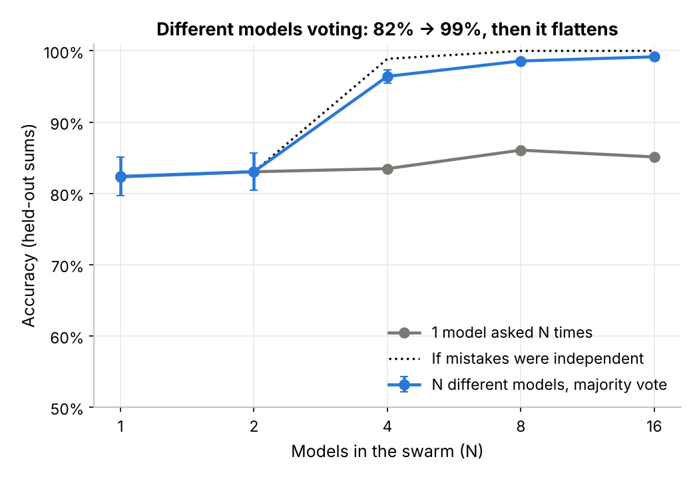

# 01 · Swarm scaling

**Goal:** find out whether a swarm of tiny models gets better *exponentially* as you add models.
**Verdict: FAIL ✨ INTRIGUING.** Voting helps a lot (82% → 99%), but error falls as a power law (∝ N^−1.44), not exponentially. The floor comes from mistakes the members share: with independent mistakes, the same members would be perfect by N=8.
**Details:** [full write-up](docs/DETAILS.md) · [plain-language explainer](EXPLAINER.md) · [all numbers](results/results.md)

| # | Criterion | Threshold | Result (3 seeds) | |
|---|---|---|---|---|
| C1 | 8 models voting beat the average model | ≥ +10 pts | +15.8 pts | ✅ PASS |
| C2 | **Core:** error falls exponentially in N | exp fit beats power law | power law fits better (ΔAIC −6.1) | ❌ FAIL |
| C3 | Diversity drives it: 8 different models vs 1 model × 8 | ≥ +5 pts | +12.5 pts | ✅ PASS |
| C4 | 4 models voting match 1 model trained 4× longer | ≥ −1 pt | −1.6 pts | ❌ FAIL |
| C5 | Adaptive stopping matches a fixed 8 with ≤ 4 calls | yes | 98.3% at 2.8 calls | ✅ PASS |

The negative control (8 clones of one model) gained exactly 0, as required.



```bash
python run.py           # full run: 7.5 min cold, ~1 min cached (4-thread Xeon @ 2.1 GHz, CPU only)
python run.py --quick   # ~8 s pipeline check
python -m pytest -q     # 15 tests, ~3 s
```

Paper: Li et al., *More Agents Is All You Need*, [arXiv:2402.05120](https://arxiv.org/abs/2402.05120). Each member is 103k parameters (0.4 MB), with 0.6 GB peak RAM.
