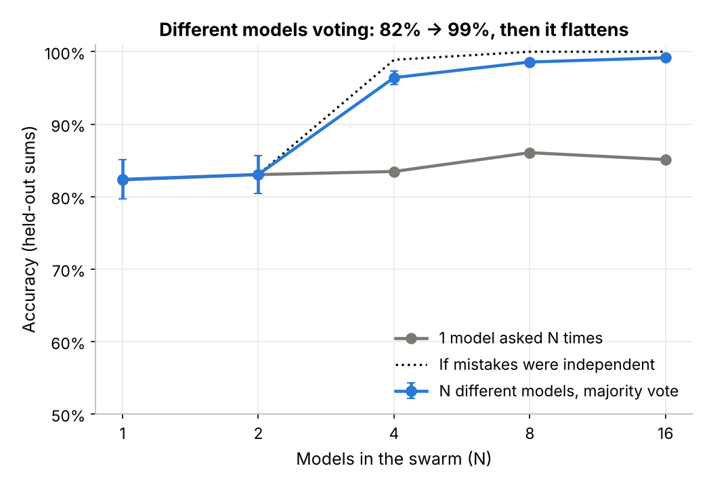
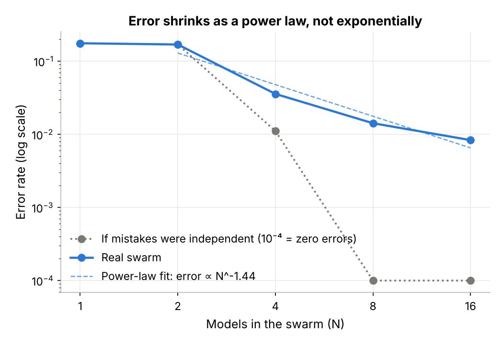
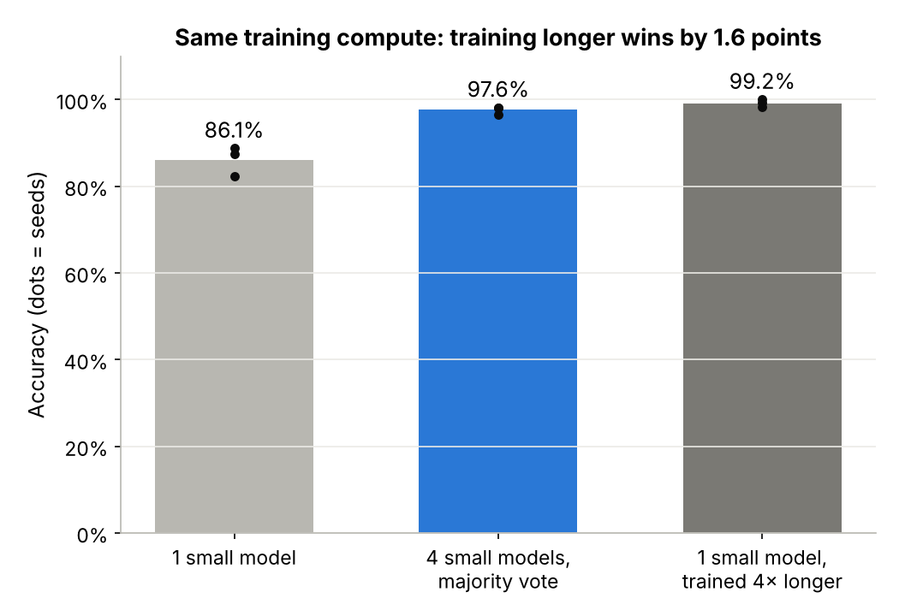

# 01 · Swarm scaling: full write-up

**Papers:** Li, Zhang, Yu, Fu, Ye. *More Agents Is All You Need.* [arXiv:2402.05120](https://arxiv.org/abs/2402.05120), TMLR 2024. Also Aggarwal et al. *Adaptive-Consistency* ([arXiv:2305.11860](https://arxiv.org/abs/2305.11860)), 2023, and Qian et al. *Scaling LLM-based Multi-Agent Collaboration* ([arXiv:2406.07155](https://arxiv.org/abs/2406.07155)), 2024.
**Why it matters on-device:** a phone or laptop can hold several 100 KB–500 MB models but not one 70B model. If many small models voting really grew smarter exponentially, that would be the cheapest route to strong offline intelligence.
**Size budget:** each member is 103k parameters (0.4 MB). Peak RAM 0.59 GB, 28.9 MB of cached models for the whole run.

## The idea in one paragraph

Ask several models the same question and take the most common answer. If the models' mistakes were independent, Condorcet's jury theorem says the chance that the majority is wrong shrinks *exponentially* as you add voters. That is where "exponential intelligence from a swarm" comes from. This experiment trains 64+ tiny transformers from scratch on 3-digit addition. Each gets its own seed and its own training data, so their mistakes differ. It then measures how the swarm's error actually falls as N grows from 1 to 16, against an independent-errors counterfactual, a clone-swarm negative control, and one model trained for the same total compute.

## Hypothesis and pass criteria

**Hypothesis:** a swarm of N diverse ~100k-parameter models gains capability exponentially in N, so majority-vote error falls like exp(−cN) rather than as a power law N^−b. Criteria are frozen in [`criteria.py`](../criteria.py). Thresholds come from the papers or theory.

| # | Criterion | Threshold | Result (mean ± sd, 3 seeds) | PASS/FAIL |
|---|---|---|---|---|
| C1 | 8 different members voting minus the average member | ≥ +10 pts | **+15.8 ± 3.5 pts** | PASS |
| C2 | **Core:** error decays exponentially (AIC of power-law fit minus AIC of exponential fit) | > 0 | **−6.1 ± 0.4** (power law fits better) | **FAIL** |
| C3 | 8 different members minus 1 member sampled 8 times | ≥ +5 pts | **+12.5 ± 2.9 pts** | PASS |
| C4 | 4-member swarm minus 1 member trained 4× longer (same training FLOPs) | ≥ −1 pt | **−1.6 ± 1.4 pts** | FAIL |
| C5 | Adaptive stopping within 1 pt of a fixed 8, using ≤ 4 calls per question | yes | **98.3% with 2.8 calls** (fixed 8: 98.6%) | PASS |

**Overall verdict: FAIL ✨ INTRIGUING.** The core claim (C2) fails, so the swarm does not get better exponentially. Error falls as a power law, roughly **error ∝ N^−1.44**. Three of the four supporting criteria pass: the swarm helps a lot, diversity is what drives it, and adaptive stopping makes it cheap.

## Controls

- **Baseline (compute-matched):** one member trained 4× longer reaches 99.2%, while a swarm of 4 reaches 97.6% (greedy decoding for both). C4 fails by 0.6 points beyond its tolerance.
- **Negative control (clone swarm):** 8 copies of one member. C1 and C3 FAIL as required (gain exactly 0.0), so the test can tell diversity from count. C2 nominally "passes" on the clones because their error curve is flat, and neither fit means anything on a flat line. That is why C2 is only read together with C1.
- **Perturbations:**

| Criterion | Main (medium members, T=0.7) | Weak members | Temperature 1.0 |
|---|---|---|---|
| C1 swarm beats members | PASS (+15.8) | PASS (+36.0) | PASS (+25.0) |
| C2 exponential decay | FAIL | FAIL | FAIL |
| C3 diversity drives it | PASS | PASS | PASS |
| C5 adaptive stopping | PASS | FAIL (95.6% with 4.6 calls) | PASS |

C2 fails in every condition. Weaker members gain more from voting (60% → 98%) but need more calls before two of them agree.

## Results



| N | 1 | 2 | 4 | 8 | 16 |
|---|---|---|---|---|---|
| N different members, majority vote | 82.4% | 83.1% | 96.4% | 98.6% | 99.2% |
| 1 member asked N times | 82.3% | 83.0% | 83.5% | 86.1% | 85.1% |
| Coverage: any member right (pass@N) | 82.4% | 96.4% | 99.6% | 100% | 100% |
| If mistakes were independent | 82.4% | 83.1% | 98.9% | 100% | 100% |
| Clone swarm (negative control) | 86.0% | 86.5% | 85.2% | 86.9% | 86.3% |

Full tables: [`results/results.md`](../results/results.md). Verdict and every metric: [`results/verdict.json`](../results/verdict.json).





## What I found that the abstract doesn't tell you

1. **The curve is S-shaped, with a short super-linear burst.** Going from 2 to 4 members adds 13 points, more than 1 → 2 did. After 8 members each doubling adds under a point. "Super-linear" is true locally and false globally.
2. **Low correlation is still enough to kill exponential scaling.** The members' mistakes are only weakly correlated (pairwise correlation 0.06–0.13 in the exploratory run). Yet the independent-errors counterfactual hits zero errors at N=8, while the real swarm is stuck at about 1%. A handful of questions that most members get wrong *the same way* sets the floor.
3. **Two voters are no better than one.** When they disagree it's a coin flip. Odd N, or confidence-weighted votes, fix that (weighted voting reached 94.7% at N=2 in the exploratory run).
4. **Sampling one tiny model many times does almost nothing.** Li et al. see gains from resampling a single LLM. A 100k-parameter model answering with 4 tokens has little sampling diversity: its mistakes are systematic.
5. **If you can train, train.** At equal training compute, one model trained 4× longer beats 4 voting models. Swarms make sense when you *can't* retrain, for example combining off-the-shelf small models on a device, or when a verifier can pick the right answer. Coverage (pass@N) hits 99.6% at N=4, far above what voting extracts.

## Run it

```bash
python run.py              # 7.5 min cold on a 4-thread Xeon @ 2.1 GHz, ~1 min once models are cached
python run.py --quick      # ~8 s, pipeline check only (the verdict is meaningless at this size)
python run.py --extended   # 32 members per pool, N up to 32, ~45 min
python run.py --clean      # delete cached models in data/
python -m pytest -q        # 15 tests, ~5 s
```

### Extension: real small LLMs (debate, mixture-of-agents, topologies)

[`llm/`](../llm/) runs the same question on real models through any local OpenAI-compatible server (Ollama, llama.cpp `llama-server`, LM Studio). It covers voting, multi-agent debate (Du et al. 2023) over `full`/`ring`/`star`/`random` topologies (Li et al. 2024), and Mixture-of-Agents (Wang et al. 2024).

```bash
ollama pull qwen2.5:0.5b
python llm/run_llm_sweep.py --config llm/llm_quick.yaml   # ~10 min
python llm/plot_llm.py llm/results/qwen2.5_0.5b.jsonl
python llm/run_llm_sweep.py --mock                         # no server needed
```

It is tested against a mock model only. No real-LLM numbers are reported here, and that run is the natural experiment 02.

## Deviations from SOP

- **Criteria written after an exploratory run.** A first exploratory sweep (seeds 0–31, test seed 999) came before `criteria.py`. To keep the verdict honest, the criteria were frozen first, with thresholds taken from papers and theory. The confirmatory run here then used fresh member seeds (100000+) and fresh test sets (seeds 2026–2028). The exploratory numbers agreed: power-law error decay of N^−1.30 to N^−1.38.
- **Full run is over the 5-minute budget on a cold cache** (7.5 min on the 4-thread machine above). It takes ~1 min once models are cached. Training 64+ members plus 3 compute-matched baselines is the cost. Lowering pool size below 16 would make the N=16 point meaningless.
- **Training ran on CPU, not Fortran's GPU** (SOP v0.3). Each member is 103k parameters and trains in about 12 s on one CPU core, so a GPU would add setup without saving meaningful time. The experiment was also built before v0.3.
- **Python 3.13** was used for the run above (CI uses 3.12). torch 2.15.0 was the CUDA wheel run on CPU, so results do not depend on it.
- **No downloaded models.** Members are trained from scratch, so there is nothing to pin to a Hugging Face revision.
- **Method code is a small package** (`swarm/`) rather than a single `<method>.py`, because the LLM extension reuses it.

## Limitations and next steps

- One synthetic task with a single right answer. That is the best case for voting. Open-ended tasks need an aggregator or a judge.
- Diversity comes from seeds and data subsets only. Mixing architectures should lower error correlation and might push the floor down.
- C4 depends on this task's sharp learning phase change, where 4× more training is unusually valuable. Tasks with smoother learning curves could favor the swarm.
- **Next:** 02 runs the LLM harness on Qwen2.5-0.5B, SmolLM2-360M and Llama-3.2-1B (mixed-vendor swarm, debate topologies). 03 tests a learned verifier or aggregator to close the gap between pass@N and vote@N.

## Related work

Du et al., *Multiagent Debate*, [arXiv:2305.14325](https://arxiv.org/abs/2305.14325) · Li et al., *Sparse communication topology for debate*, [arXiv:2406.11776](https://arxiv.org/abs/2406.11776) · Wang et al., *Mixture-of-Agents*, [arXiv:2406.04692](https://arxiv.org/abs/2406.04692) · Chen et al., *Are More LLM Calls All You Need?*, [arXiv:2403.02419](https://arxiv.org/abs/2403.02419) · Brown et al., *Large Language Monkeys*, [arXiv:2407.21787](https://arxiv.org/abs/2407.21787) · Smit et al., *Should we be going MAD?*, [arXiv:2311.17096](https://arxiv.org/abs/2311.17096) · Wang et al., *Self-Consistency*, [arXiv:2203.11171](https://arxiv.org/abs/2203.11171) · Krogh & Vedelsby 1995, *Neural network ensembles* · Condorcet 1785.
