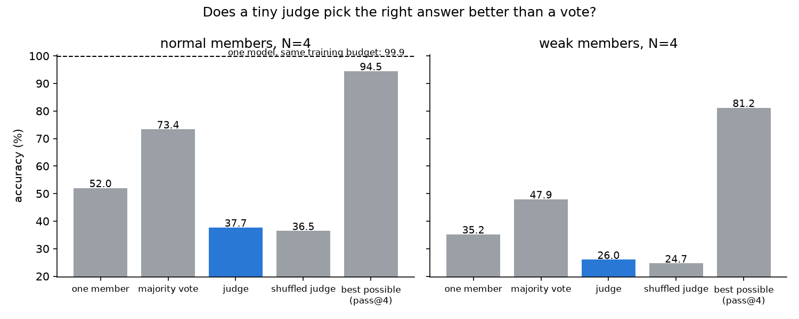

# 04 · A tiny learned checker for swarms

**Goal:** a judge no bigger than one tiny model picks the swarm's right answer better than a majority vote.

**Verdict: FAIL** (1/4). The judge picked worse than the plain vote (38% vs 73%), and no better than a judge trained on shuffled labels. At this size, checking a sum turned out to be as hard as computing it. → [details](docs/DETAILS.md) · [plain-English explainer](EXPLAINER.md)

| ID | Criterion | Result | Pass if | |
|---|---|---|---|---|
| C1 (core) | Share of the vote → best-of-4 gap the judge closes | −181% | ≥ 50% | FAIL |
| C2 | Swarm of 4 + judge vs one model on the same training budget | −62 pts | ≥ −1 pt | FAIL |
| C3 | Judge size vs one member | 0.99× | ≤ 1× | PASS |
| C4 | Gap closed on weaker members | −67% | ≥ 30% | FAIL |

Negative control (shuffled-label judge) also fails C1, as it must. 3 seeds, RTX 4080 SUPER, 1.9 min training, 23.6 MB of models (not kept).



```bash
python run.py          # full run, NVIDIA GPU only (~2 min of training)
python run.py --quick  # CPU smoke check of the pipeline (not a result)
python run.py --clean  # delete cached models
```
